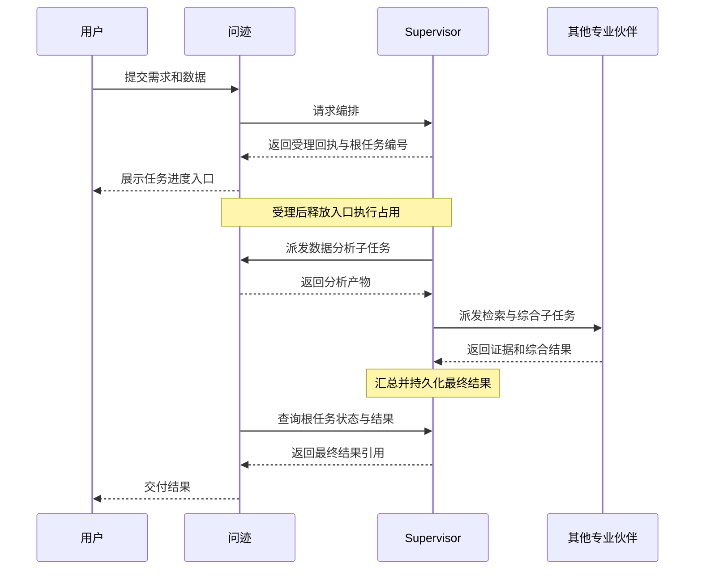

# 多入口接入与 Supervisor 统一编排实施计划

> 日期：2026-11-17  
> 状态：设计计划，尚未完成本方案的实现与端到端验收。  
> 目标：允许用户从不同 Partner 发起任务，由 Partner 主动请求 Supervisor 编排；Supervisor 统一调度专业 Partner，完成结果交付，同时避免递归转派和循环等待。

## 1. 设计决策

保留 Supervisor 作为集群任务的统一编排者。各 Partner 同时具备两种职责：作为入口接收外部需求，作为执行者处理 Supervisor 派发的专业子任务。

两个方向分别具有明确的业务含义：

- **Partner → Supervisor：调用编排能力。** 提交用户需求、可访问的输入材料和交付要求，获取任务受理信息与最终结果。
- **Supervisor → Partner：调用专业能力。** 下发具体子任务，获得数据分析、文献检索、写作等产物。

外部需求可以从不同入口进入，但每个根任务只由 Supervisor 建立一份编排记录。Partner 不把已收到的执行子任务重新提交为新科研需求。

进度报告、失败报告和结果回传仍属于原任务生命周期，不单独作为“反向调用编排能力”的证明。

## 2. 范围与现有基础

### 2.1 本期范围

1. 首先选择问迹作为入口 Partner，打通一条真实科研任务链。
2. 保留用户直接调用 Supervisor 的现有入口。
3. 问迹收到外部科研需求后，向 Supervisor 提交编排请求；收到 Supervisor 子任务后直接执行。
4. Supervisor 可以将数据分析子任务交回问迹，并调用其他伙伴完成其余步骤。
5. 用户在原入口查看进度和最终结果。
6. 完成来源验证、重复提交处理、生命周期管理和双向调用取证。

之后将同一接入约定推广到其他需要面向用户的 Partner。资源型 Partner 的静态能力、健康检查及公开元数据查询保留原有路径，不因本方案强制进入科研编排。

### 2.2 当前代码可复用部分

以下依据当前工作区文件梳理，不表示已部署或已验证线上可用。

| 现有基础 | 可复用内容 | 本方案仍需补齐 |
|---|---|---|
| `agents/supervisor.py` | 伙伴发现、委派、等待、汇总；外部入站与准入控制 | 显式编排提交入口、统一根任务上下文 |
| `agents/partner_supervisor.py` | Supervisor 常驻与恢复相关逻辑 | 核实新入口的排队、恢复及并发处理方式 |
| `delegation/` | PEP、身份与委托令牌约束 | 将入口、执行、报告权限绑定到对应任务 |
| `runtime/jobs_store.py` | 作业状态存储基础 | 评估根任务映射、幂等受理、结果交付能否复用 |
| `bidirectional/` | 探针、回执、双向证据打包 | 增加真实业务链的根任务关联与验收 |
| `docs/bidirectional-invocation.md` | 当前双向接入及取证说明 | 与本计划分工：该文档说明验证工具，本计划说明业务架构 |

当前公开能力 `research.orchestrate` 为只读调度信息能力，不能直接等同于本计划中的“受理并执行完整科研任务”。新增业务入口应使用独立能力名称，保留已有只读语义。

## 3. 目标业务流程

示例需求：“分析这组实验数据，并结合相关论文解释结果。”

第一次问迹调用 Supervisor 时，问迹是任务入口；Supervisor 再调用问迹时，问迹是子任务执行者。两个请求使用不同的平台任务标识，通过同一个业务根任务关联。

Supervisor 接受请求后先持久化，再返回回执。入口提交调用交付的是“已受理”结果，不需要等待整条科研流程完成。业务任务状态与该次平台调用状态分别记录，避免把受理成功展示为科研任务完成。

## 4. Partner 的请求分流

分流由代码根据经过验证的来源、请求类型和任务记录决定，不以模型解释或正文里的“我是 Supervisor”为依据。

| 请求类型 | 来源及校验 | 执行动作 | 是否创建新的根任务 |
|---|---|---|---|
| 外部科研需求 | 用户入口完成身份与会话校验 | 调用 Supervisor 编排提交能力 | 仅首次受理创建 |
| 专业子任务 | 验证 Supervisor 身份、授权及任务关联 | 执行指定专业能力 | 否 |
| 补充输入 | 验证用户或调用方对原任务的权限 | 关联原任务并继续处理 | 否 |
| 进度、缺口或失败报告 | 验证报告方为该子任务执行者 | 更新状态，由 Supervisor 决定后续动作 | 否 |
| 结果查询或交付 | 验证入口和用户对根任务的访问权 | 查询或交付持久化结果 | 否 |

缺少上下文、来源不符、任务已终止或子任务不存在的执行请求应明确拒绝，不能自动降级成“外部新任务”。如果 Partner 还支持其他外部智能体接入，应为其定义独立的认证入口规则。

## 5. 接口与任务上下文草案

本节名称是建议的应用层约定，开发前需与现有 SDK、能力声明及存储结构核对，不代表协议已有标准字段。

### 5.1 Supervisor 对外能力

| 建议能力 | 用途 | 返回内容 |
|---|---|---|
| `research.submit` | 受理入口 Partner 的完整科研需求 | 根任务编号、受理状态、查询方式 |
| `research.status` | 查询进度和结果 | 业务状态、当前阶段、结果引用或失败说明 |
| `research.report` | 接收子任务缺口或异常报告 | 报告受理状态；后续安排由调度器处理 |
| `research.cancel` | 取消已授权的根任务 | 取消受理状态及不能立即中止的在途工作说明 |

如果现有任务状态通道能覆盖报告功能，应优先复用，不额外建立语义重复的接口。第一版结果交付采用入口查询；主动推送留待后续，避免首期同时维护两套交付机制。

### 5.2 必要上下文

| 字段 | 用途及生成规则 |
|---|---|
| `request_id` | 入口为一次用户提交生成，网络重试保持不变 |
| `root_task_id` | Supervisor 首次受理时生成，后续调用统一继承 |
| `subtask_id` | Supervisor 为专业子任务生成；入口提交时不必存在 |
| `parent_task_id` | 关联业务父任务；不得与平台 AIP taskId 混为同一标识 |
| `request_kind` | 区分提交、执行、报告、查询和取消 |
| `entry_partner_aic` | 记录原入口，由验证后的调用身份绑定 |
| `orchestrator_aic` | 记录该根任务的编排者，由服务端确定 |
| `user_scope` | 绑定用户或租户权限，防止跨会话读取任务 |
| `input_refs` | 输入材料引用及允许访问的范围 |
| `deadline_at` | 根任务截止时间，子任务不能延长 |
| `attempt` | 执行尝试编号；重试不改变业务根任务身份 |

调用身份从连接认证和现有授权机制取得；正文传入的 AIC、用户标识及任务编号仅作待校验数据。数据引用必须可被获授权的执行者访问，不能把入口机器上的本地路径直接当成跨智能体可用附件。

幂等键建议为“已认证入口身份 + 用户作用域 + request_id”。同键同内容返回已有任务；同键不同内容返回冲突，不覆盖原任务。受理记录与入队应具备原子性或可恢复的持久化交接，防止返回成功后任务丢失。

## 6. 防循环与避免循环等待

### 6.1 必须成立的流程约束

1. **同一用户提交只受理一次。** 重试命中幂等记录，不重复创建根任务。
2. **同一根任务只由 Supervisor 编排。** Partner 可以报告执行需求，不能重新提交整项任务或擅自创建新的编排层。
3. **子任务进入执行路径。** 已验证的 Supervisor 子任务不得转入外部需求入口。
4. **报告只更新原任务。** 报告、查询、结果交付不触发新的 `research.submit`。
5. **所有重试和补充工作继承根任务限制。** 新 run、进程恢复或模型重启不得刷新任务预算。

前四条消除本方案正常流程中的递归转派；第五条约束失败重试和反复补充造成的无界执行。不能仅凭双向箭头或单次模型步数上限宣称系统绝不会循环。

### 6.2 避免入口等待占用执行位置

若问迹一直占用唯一执行位置等待 Supervisor，而 Supervisor 又等待问迹分析数据，就会发生循环等待。

第一版采用“短时受理 + 后台编排 + 结果查询”：

- Supervisor 持久化受理后立即返回任务编号，后台工作者推进根任务。
- Partner 完成入口提交后释放工作者和会话锁，不占用专业子任务执行位置。
- 前端进度查询与专业任务执行使用独立请求上下文，查询不长期持有执行锁。
- Supervisor 的受理、报告、查询入口不能被长时间等待某个 Partner 的编排过程阻塞。

业务根任务、入口会话和子任务执行上下文分别保存。特别验证问迹只有一个专业执行工作者时，入口提交后仍可处理回派子任务。

### 6.3 有界执行的初始配置建议

以下是联调起点，不是现有默认值或已验证的性能指标。

| 控制项 | 建议初值 | 处理方式 |
|---|---|---|
| 每个子任务自动重试 | 最多 2 次，即最多 3 次执行尝试 | 超限报告失败，不继续自动重试 |
| 同一缺口的补充轮次 | 最多 2 轮 | 仍缺信息则转为等待输入或明确失败 |
| 根任务总委派数 | 最多 20 次，重试也计入 | 达限停止新委派，保存已完成结果和未完成项 |
| 根任务运行期限 | 按任务类型配置 | 到期停止新调度并处理在途任务 |

预算记录需持久化，并发派发时原子扣减。现有令牌链深限制、单次 run 预算和运行守卫继续保留，但不代替根任务级约束。

## 7. 状态、异常与交付

业务根任务建议使用以下应用层状态；与 SDK 平台状态建立显式映射，不直接混用。

| 状态 | 含义 |
|---|---|
| `accepted` | 需求已持久化并等待调度 |
| `running` | Supervisor 正在推进子任务 |
| `needs_input` | 等待用户补充信息，执行占用已释放 |
| `completed` | 最终结果已持久化，交付要求已满足 |
| `failed` | 无法满足交付要求，保留原因和已有产物 |
| `cancelled` | 已取消；记录尚未停止的外部工作 |
| `expired` | 根任务期限已到 |

处理约定：

- Supervisor 不可用：入口明确显示提交失败或待重试，不能显示“已受理”。
- 受理响应丢失：以原幂等键重试，取得同一根任务编号。
- Partner 执行失败：只报告当前子任务，由 Supervisor 决定是否重试、改派或终止。
- 用户补充材料：继续原根任务；不重新开启整条流程。
- 取消与超时：停止后续调度，向在途工作传递终止请求；迟到结果只能留档，不能把终止任务自动恢复为成功。
- 进程重启：恢复任务记录与原预算，按租约或等价机制避免两个工作者同时推进同一根任务。不可安全重放的操作先核对执行状态。
- 结果交付失败：保留已完成结果，允许入口重新获取；交付重试不能重新执行科研任务。

第一版接受 Supervisor 作为集中依赖的架构取舍，通过持久化、恢复和明确失败状态处理不可用情形；暂不引入多总控接管。

## 8. 分阶段实施

按依赖推进，每阶段满足退出条件后进入下一阶段，不预设未经评估的工期。

| 阶段 | 工作内容 | 交付物与退出条件 |
|---|---|---|
| P0：接口核对 | 核实 SDK 的异步受理、平台关单、身份传递及问迹并发机制；确定存储复用方案 | 接口和状态映射确定；确认入口等待不会占用执行位置 |
| P1：根任务受理 | 实现提交、查询、幂等、准入、持久化入队；保留原只读能力 | 重复提交只产生一个根任务；未经授权的提交被拒绝 |
| P2：问迹分流 | 接入外部需求转编排；验证 Supervisor 来源后执行专业子任务 | 同一问迹可以先提交需求，再执行回派子任务 |
| P3：完整编排 | 串接数据分析、文献检索、综合与结果交付；传递任务和数据权限 | 用户能在原入口取得实际业务结果 |
| P4：异常治理 | 加入根预算、缺口报告、有限重试、取消、超时和重启恢复 | 循环转派、相互等待和重复执行相关测试通过 |
| P5：平台取证 | 使用真实双方身份运行链路，扩展回执关联与导出 | 两个方向均有真实调用记录、产物及业务关联证据 |
| P6：推广接入 | 抽取公共入口适配逻辑，按需接入其他 Partner | 新 Partner 通过同一套分流和异常验收 |

建议改动位置：

- `acps_cluster/agents/supervisor.py`：能力入口与后台编排的衔接。
- `acps_cluster/runtime/`：根任务存储、调度和恢复；评估复用现有作业组件。
- `partners/wenji/backend/`：外部需求接入、子任务分流和结果查询。
- `acps_cluster/delegation/`：来源验证、作用域检查及调用上下文传递。
- `acps_cluster/bidirectional/`：根任务关联、真实业务证据及已有探针能力复用。
- `acps_cluster/tests/` 与问迹测试目录：分流、幂等、并发和失败场景覆盖。

具体文件拆分在 P0 确定。以上是计划改动范围，本次文档编写不修改运行逻辑、配置或线上服务。

## 9. 验收清单

| 编号 | 验收场景 | 必须观察到的结果 |
|---|---|---|
| A1 | 用户直接调用 Supervisor | 原有编排入口仍正常完成任务 |
| A2 | 用户从问迹提交科研需求 | 问迹主动调用 Supervisor 并获得真实受理回执 |
| A3 | Supervisor 回派问迹 | 问迹执行分析子任务，没有再提交完整编排请求 |
| A4 | 单工作者回派 | 入口提交释放执行占用，回派任务能够推进 |
| A5 | 网络重试及并发重复提交 | 同一幂等键只创建一个根任务；不同内容冲突被拒绝 |
| A6 | 伪造来源或任务字段 | 不能进入受信执行路径，不能越权查询或取消任务 |
| A7 | 子任务反复失败或请求补充 | 达到原任务限制后停止；计数不因新 run 重置 |
| A8 | 用户补充输入 | 原任务恢复，不创建新的根任务 |
| A9 | 超时、取消及迟到结果 | 不再新建子任务；迟到结果不改变终止结论 |
| A10 | Supervisor 重启 | 已受理任务不丢失，预算保留，避免重复推进 |
| A11 | 最终结果查询重试 | 返回已有结果，不重复执行科研工作 |
| A12 | 端到端双向调用 | caller/callee 互换、平台 taskId 不同、产物可核验，并关联同一业务根任务 |

文档完成不等于上述验收通过。阶段交付时逐项记录实际结果、失败原因和证据位置。

## 10. 演示与证据计划

演示从用户向问迹提出真实科研需求开始，展示问迹请求编排、Supervisor 回派数据分析、调用其他伙伴以及最终返回用户的全过程。

归档内容至少包含：

1. 问迹 → Supervisor 的编排请求、受理产物与平台任务编号。
2. Supervisor → 问迹 的专业子任务、分析产物与另一平台任务编号。
3. 两条调用的认证身份、时间、终态及同一 `root_task_id` 的关联记录。
4. 根任务最终结果和用户入口交付记录，区分受理成功与业务完成。
5. 分流记录与根任务计数，能够确认执行子任务未重新进入编排提交入口。
6. 与平台任务编号对应的后台截图或交互记录。

已有探针适合连通性和协议验证。完整方案的验收必须补充“用户入口触发的真实业务流程”，不能仅凭两个独立探针成功就宣称该业务架构已经完成。

本计划定义工程验收标准，不替代赛事官方对双向调用的认定；比赛材料应依据实际运行证据描述。

实现并验收后，可使用以下表述：

> 研枢采用多入口接入、统一编排、专业执行的协作机制。Partner 可主动调用 Supervisor 请求科研任务编排，Supervisor 按需调用各 Partner 的专业能力；通过经过验证的任务来源、明确的请求分流和共享任务预算，避免递归转派与无界执行。

## 11. 完成定义

- 问迹入口的完整科研任务能够实际运行并交付结果。
- 正向专业调用与反向编排调用均有可核验记录。
- 请求分流、释放执行占用、幂等受理及异常治理验收通过。
- 新入口遵守现有身份和权限约束，已有只读能力和直接调用路径兼容。
- 文档、能力声明、演示视频及平台证据与实际实现一致。

相关文档：[双向调用验证与取证](bidirectional-invocation.md)、[入站产物交付](inbound-result-delivery-aip-submit.md)、[任务工作区设计](design-task-workspace.md)、[运行守卫](run-guard.md)。
